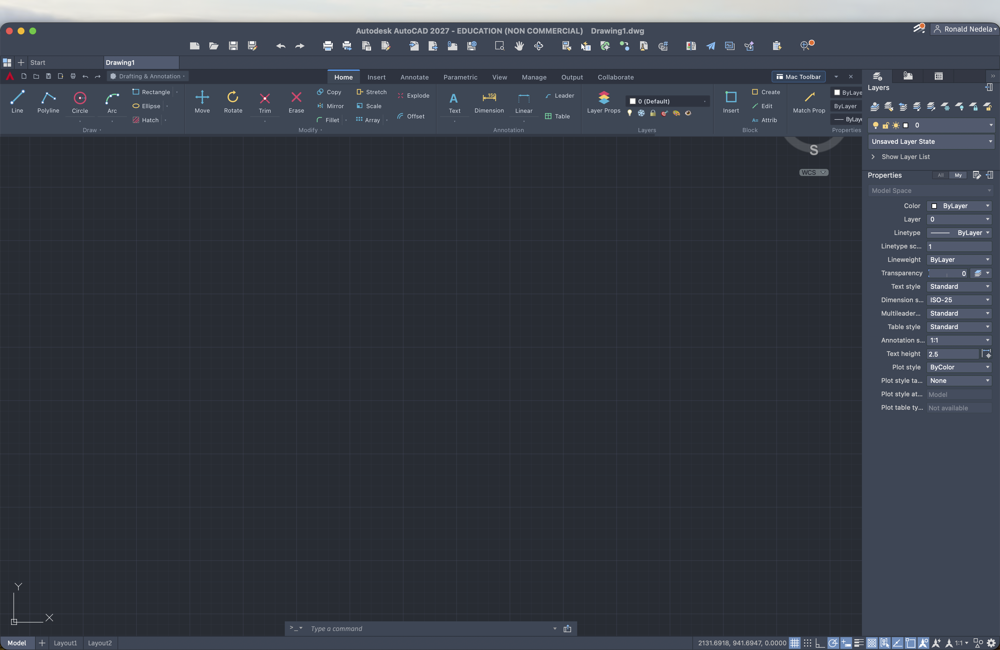
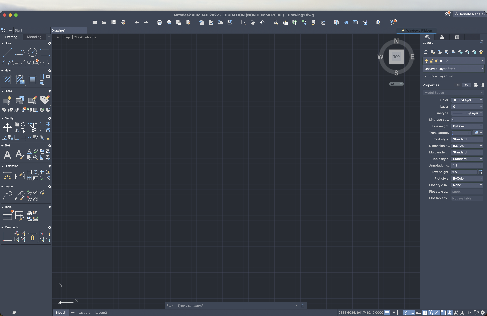

# AutoCAD for Mac — Windows Ribbon Toolbar

[](https://www.apple.com/macos/)
[](https://www.autodesk.com/products/autocad)
[-blue)](#compatibility)
[](LICENSE)

A native, high-performance plugin for **AutoCAD for Mac** that brings back the full **Windows-style horizontal Ribbon** across the top of the screen.

Designed for architects, mechanical engineers, and drafters switching from Windows to macOS who want their muscle memory, standard top-docked toolsets, and full-width canvas back.

---

## 📸 Preview



*Windows Ribbon mode in AutoCAD 2027 on macOS Sequoia with dynamic theme adaptation and auto-hidden side palettes.*

---

## ⚡️ Key Features

- **Standard Windows Layout**: All tools organized horizontally across the top into standardized panels (Draw, Modify, Annotation, Layers, Block, Properties, Utilities, Clipboard).
- **Comprehensive 7-Tab Navigation**:
  - **Home**: Draw (Line, Polyline, Circle, Arc, Rectangle, Ellipse, Hatch), Modify (Move, Rotate, Trim, Erase, Copy, Mirror, Fillet, Stretch, Scale, Array, Explode, Offset), Annotations, Layers, Blocks, Properties.
  - **Insert**: Block insertion, Xref management, raster images, DWF/PDF underlays, point clouds.
  - **Annotate**: Multiline text, Linear/Aligned dimensions, Multileaders, Tables, markup tools.
  - **Parametric**: Geometric constraints (Coincident, Parallel, Perpendicular, Tangent) and Dimensional constraints.
  - **View**: Real-time Pan, Zoom window/extents, UCS manager, Named views, Viewport configurations.
  - **Manage**: Purge, Audit, AppLoad, Script runner, CUI editor.
  - **Output**: Plot, Page Setup, Batch Plot, Export to PDF, eTransmit.
  - **Collaborate**: Shared Views, DWG Compare, Activity Insights.
- **Dynamic Theme Synchronization**: Samples AutoCAD’s exact window palette in real time and automatically adapts to dark and light modes.
- **Screen Boundary-Aware Menus**: Flyout submenus detect screen edges and automatically flip orientation to prevent clipping.
- **One-Click & Command-Based Switching**:
  - Type `RIBBON` or `MR` in the AutoCAD command line to switch to the Windows Ribbon.
  - Type `RIBBONCLOSE` or click **"Mac Toolbar"** in the top bar to restore the classic vertical Mac toolset.
- **True Drag-and-Drop Installation**: Zero command-line knowledge required. Just drop `MacRibbon.bundle` into your Autodesk Addins folder and launch AutoCAD.
- **Universal Binary**: Compiled natively for both **Apple Silicon (M1/M2/M3/M4)** and **Intel (x86_64)**.

---

## 🕹 AutoCAD Commands

| Command | Action |
| :--- | :--- |
| `RIBBON` | Enables the Windows Ribbon, closes the vertical Mac toolsets, and auto-docks palettes. |
| `MR` | Convenient short alias for `RIBBON`. |
| `RIBBONCLOSE` | Restores the classic macOS floating/docked Tool Sets palette and displays a quick-switch button. |

---

## 📦 Installation

### Method 1: Drag & Drop (Recommended)
1. Download or locate `MacRibbon.bundle` (available in the [Releases](../../releases) tab or inside the `build/` folder).
2. Copy or drag `MacRibbon.bundle` into:
   ```text
   ~/Library/Application Support/Autodesk/ApplicationAddins/
   ```
   *(Shortcut: In Finder, press `Cmd + Shift + G`, paste the path above, and press Enter).*
3. Launch or restart AutoCAD. The Ribbon will automatically load.

---

### Method 2: 1-Click Installer (Pre-Packaged)
If using the bundled installer:
1. Open the `MacRibbon-Installer` folder on your Desktop.
2. Double-click `Telepites_1-Kattintassal.command` (or drag `MacRibbon.bundle` onto `Húzd_ide_az_Autodesk_Addinsbe`).
3. Start AutoCAD.

---

### Method 3: Build from Source
If you are modifying the source code:
```bash
git clone https://github.com/your-username/AutoCAD-Mac-Ribbon.git
cd AutoCAD-Mac-Ribbon
make install
```
This compiles the Universal binary, signs the bundle, copies all web assets, and registers the autoloader.

---

## 🔄 Dual Workspace Mode

You can switch back and forth between the macOS classic toolbar and the Windows Ribbon at any time without restarting AutoCAD:



- **In Windows Ribbon mode**: Click the **"Mac Toolbar"** button in the upper-right corner of the Ribbon or type `RIBBONCLOSE`.
- **In Mac Toolbar mode**: Click the **"⚡️ Windows Ribbon"** button in the top menu bar or type `RIBBON` / `MR`.

---

## 🏗 Architecture & Under the Hood

```
AutoCAD-Mac-Ribbon/
├── src/
│   ├── main.mm                 # ObjectARX entry point (acrxEntryPoint) & app lock
│   ├── CommandExecutor.h/.mm   # Dual-engine CAD dispatch (sendStringToExecute + AppleScript)
│   ├── RibbonViewController.h/.mm # WebKit-based Ribbon host controller
│   └── RibbonManager.h/.mm     # Window detection, theme sampling, and lifecycle manager
├── ui/
│   ├── index.html              # Ribbon markup with vector icons
│   ├── style.css               # Dynamic theme-aware CAD styling
│   ├── ribbon.js               # Event handling, dropdown logic, and command bus
│   └── macribbon.lsp           # Universal AutoLISP companion & startup hook
├── PackageContents.xml         # Autodesk Autoloader manifest
├── Info.plist                  # macOS bundle metadata
└── Makefile                    # Universal binary compiler and deploy script
```

- **Native AppKit Overlay**: Intercepts the `AcMainWindow` NSWindow, injecting an ultra-crisp WebKit view directly beneath the standard macOS title bar.
- **Dual-Engine Command Dispatch**: Native commands are fed directly to AutoCAD’s command loop via dynamic symbol resolution (`acedPostCommand` / `sendStringToExecute`), ensuring instant execution without UI lag.
- **Crash-Proof ABI**: Designed without brittle static bindings to internal Autodesk private symbols, guaranteeing forward-compatibility across AutoCAD versions.

---

## 💻 Compatibility

| Component | Minimum Version | Tested & Supported |
| :--- | :--- | :--- |
| **AutoCAD for Mac** | 2024 (R24.3) | 2024, 2025, 2026, 2027 (R26.0)+ |
| **macOS** | Sonoma (14.0) | macOS 14 Sonoma, macOS 15 Sequoia |
| **Architecture** | 64-bit | Apple Silicon (`arm64`), Intel Core (`x86_64`) |

---

## 🛠 Uninstallation

To remove the plugin:
```bash
make uninstall
```
Or simply delete the bundle from:
```text
~/Library/Application Support/Autodesk/ApplicationAddins/MacRibbon.bundle
```

---

## 📄 License

This project is licensed under the [MIT License](LICENSE).
AutoCAD is a registered trademark of Autodesk, Inc. This project is an independent community extension and is not affiliated with or endorsed by Autodesk.
