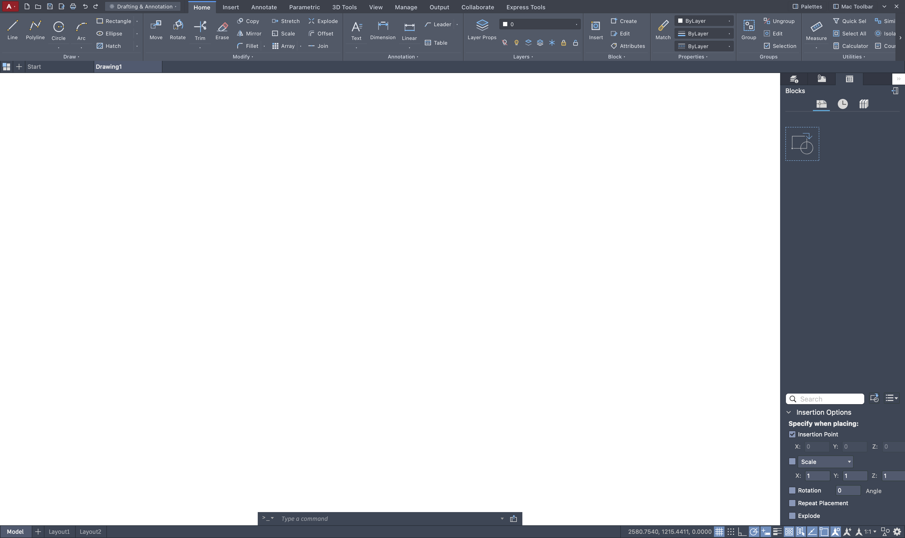
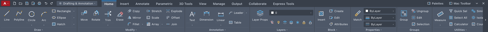
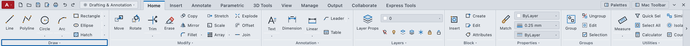

# AutoCAD for Mac: Windows Ribbon Toolbar

[](https://www.apple.com/macos/)
[](https://www.autodesk.com/products/autocad)
[-blue)](#system-and-software-compatibility)
[](CHANGELOG.md)
[](LICENSE)

A native plugin for **AutoCAD for Mac** that mounts a Windows-style horizontal **Ribbon** across the top of the main drawing window.

Built for architects, mechanical engineers, and CAD users moving between Windows and macOS who want standard top-docked ribbon tabs, verified AutoCAD for Mac commands, and full-width canvas layout.

---

## Interface Preview



*Windows Ribbon v2.0.0 running inside AutoCAD for Mac 2027 with native matte drafting icons, live AutoCAD theme synchronization, and automatic top spacer reservation.*

### Dark & Light Theme Close-Up





---

## Features

- **10-Tab Windows Ribbon Layout** (every command verified against AutoCAD for Mac 2027):
  - **Home:** Draw (Line, Polyline, Circle, Arc, Rectangle/Polygon, Ellipse, Hatch + extended tray), Modify (Move, Rotate, Trim/Extend, Erase, Copy, Mirror, Fillet/Chamfer/Blend, Stretch, Scale, Array, Explode, Offset, Join + Change Properties, Change Space, Break at Point), Annotation, Layers (live drawing layer sync + quick layer toggles), Block, Properties (Color, Lineweight, Linetype), Groups, Utilities (Measure, Quick Select, Select Similar, Isolate/Hide Objects, Count, Calculator), Clipboard, and View.
  - **Insert:** Insert, Blocks/Content palette, Block Editor, Attribute tools (Define, Manage, Sync, Edit), Attach DWG/PDF/Image, Xref Palette, Clip, Image Adjust, Xbind, PDF Import, PDF SHX Text Recognition, Fields, and Data Links.
  - **Annotate:** MText, Single Line Text, Spell Check, Find/Replace, Full Dimensioning (Dim, Linear, Aligned, Angular, Radius, Diameter, Continue, Baseline, Space, Break, Jogged Line, Tolerance), Center Mark/Centerline, Multileaders (Add, Remove, Align, Collect), Tables, and Revision Cloud/Wipeout.
  - **Parametric:** Infer Constraints, all 12 Geometric Constraints, all 6 Dimensional Constraints, AutoConstrain, Constraint Bar visibility, Dynamic Constraint display, Constraint Settings, and Parameters Manager.
  - **3D Tools:** Solids (Box, Extrude, Presspull, Cylinder, Sphere, Cone, Wedge, Pyramid, Torus, Polysolid, Revolve, Sweep, Loft), Solid Editing (Union, Subtract, Intersect, Slice, Thicken, Solid Edit, Fillet/Chamfer Edge, Interfere), 3D Operations (3D Move/Rotate/Scale/Mirror, Section Plane, Flatshot), Conversions, Materials, and Render.
  - **View:** Pan, Zoom, 3D Orbit, ViewCube, UCS Icon, UCS, Viewports, Named Views, Visual Styles (2D Wireframe, Conceptual, Hidden, Realistic, Shaded, X-Ray), and Palettes (Properties, Layers, Content, Tool Sets, Command Line, Sheet Set Manager, Materials, Count List, Reset Palettes).
  - **Manage:** CUI, Command Aliases (PGP), AppLoad, Run Script, Audit, Purge, Recover, Units, and Options/Preferences.
  - **Output:** Plot, Batch Plot, Preview, Page Setup, Export PDF, Export (DXF/STL/DWG/BMP), Export Layout to Model, and eTransmit.
  - **Collaborate:** Share, DWG Compare, Traces, Markup Import, Markup Assist, and Activity Insights.
  - **Express Tools:** Verified macOS Express commands including Burst, Count, Replace Block, Copy Nested, Convert to MText, Super Hatch, Break-line, Overkill, and Flatten.
- **Theme-Adaptive Matte CAD Icons:** 406 custom vector SVG icons styled via CSS variables to match AutoCAD's native Dark and Light themes with WCAG AA (4.5:1+) text contrast.
- **Live Drawing Layer Synchronization:** Automatically reads the open drawing's layer table, colors, and active properties (`CLAYER`, `CECOLOR`, `CELWEIGHT`, `CELTYPE`), with on-demand refresh via `MRSYNC`.
- **Keyboard Accessible:** Full `Escape` dismissal, `ArrowLeft`/`ArrowRight` tab navigation, `ArrowUp`/`ArrowDown` menu navigation, native `<button>` semantics, `:focus-visible` rings, and `prefers-reduced-motion` support.
- **One-Click Mode Switching:** Switch between the Windows Ribbon (`RIBBON` or `MR`) and classic macOS Tool Sets (`RIBBONCLOSE` or the **Mac Toolbar** button) without restarting AutoCAD.
- **Universal Binary:** Native `arm64` (Apple Silicon) and `x86_64` (Intel) bundle.

---

## Registered AutoCAD Commands

| Command | Description |
| :--- | :--- |
| `RIBBON` | Enables the Windows Ribbon toolbar and collapses the left macOS Tool Sets palette. |
| `MR` | Short alias for `RIBBON`. |
| `RIBBONCLOSE` | Hides the Windows Ribbon, restores the native macOS Tool Sets palette, and displays the `Windows Ribbon` toggle button. |
| `MRSYNC` | Refreshes the Ribbon's Layers and Properties dropdowns from the active drawing. |

---

## Installation

### Option 1: Install Prebuilt Bundle from Releases
1. Download `MacRibbon-v2.0.0.zip` from [GitHub Releases](https://github.com/RonaldNedela/AutoCAD-Mac-Ribbon/releases) and extract `MacRibbon.bundle`.
2. Copy `MacRibbon.bundle` into your AutoCAD ApplicationAddins directory:
   ```text
   ~/Library/Application Support/Autodesk/ApplicationAddins/
   ```
   *(Create the directory if it does not exist.)*
3. Restart AutoCAD for Mac. The Ribbon loads automatically on startup and on every drawing.

### Option 2: Build and Install from Source
Prerequisites: Xcode Command Line Tools (`xcode-select --install`) and Python 3.

```bash
git clone https://github.com/RonaldNedela/AutoCAD-Mac-Ribbon.git
cd AutoCAD-Mac-Ribbon
make install
```

`make install` generates `ui/index.html`, compiles the Universal Binary (`arm64` + `x86_64`), ad-hoc signs the bundle, copies `MacRibbon.bundle` to both `ApplicationAddins` and `ApplicationPlugins`, and configures the AutoLISP autoload hooks.

---

## Switching Between Windows Ribbon and Mac Tool Sets

```text
[ Classic Mac Tool Sets ]  <-- RIBBONCLOSE / "Mac Toolbar" | RIBBON / MR -->  [ Windows Ribbon ]
```

1. **Windows Ribbon Mode (`RIBBON` / `MR`):** Mounts the 115px horizontal Ribbon above the File Tabs bar by adjusting AutoCAD's native top layout spacer, preventing overlap with the canvas, ViewCube, or right-hand Inspector.
2. **Classic Mac Tool Sets Mode (`RIBBONCLOSE`):** Restores the native macOS Tool Sets sidebar and places a compact `Windows Ribbon` button in the top bar for one-click switching back.

---

## Project Structure

```text
AutoCAD-Mac-Ribbon/
├── PackageContents.xml           # Autodesk Autoloader manifest
├── Info.plist                    # Bundle metadata
├── Makefile                      # Universal Binary build & install targets
├── CHANGELOG.md                  # Release history
├── scripts/
│   ├── cad_icons.py              # Theme-adaptive Autodesk CAD SVG icon library
│   ├── generate_ribbon.py        # 10-tab semantic HTML generator
│   └── setup_acad_lsp.py         # AutoCAD roaming Support autoload configurator
├── ui/
│   ├── index.html                # Generated ribbon markup
│   ├── style.css                 # Dark & Light matte CAD stylesheet
│   ├── ribbon.js                 # Controller, keyboard a11y, state sync
│   └── macribbon.lsp             # AutoLISP commands (RIBBON, MR, RIBBONCLOSE, MRSYNC)
└── src/
    ├── main.mm                   # ObjectARX entry point & memory lock
    ├── RibbonManager.h/.mm       # AcMainWindow attachment, theme sync, layout spacer
    ├── RibbonViewController.h/.mm# WKWebView host & JS-native bridge
    └── CommandExecutor.h/.mm     # CUI macro dispatch via CCmdThroat
```

---

## System and Software Compatibility

- **Host Software:** Autodesk AutoCAD for Mac 2024, 2025, 2026, and 2027+.
- **Operating Systems:** macOS 14 Sonoma, macOS 15 Sequoia, and newer.
- **Hardware Architecture:** Apple Silicon (`arm64`) and Intel (`x86_64`).

---

## Uninstallation

```bash
rm -rf ~/Library/Application\ Support/Autodesk/ApplicationAddins/MacRibbon.bundle
rm -rf ~/Library/Application\ Support/Autodesk/ApplicationPlugins/MacRibbon.bundle
```

Restart AutoCAD to return to the default macOS interface.

---

## Changelog

See [CHANGELOG.md](CHANGELOG.md) for the full list of changes in each release.

## Author

- Ronald Nedela ([@RonaldNedela](https://github.com/RonaldNedela))

## License

Licensed under the [MIT License](LICENSE).
